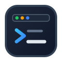
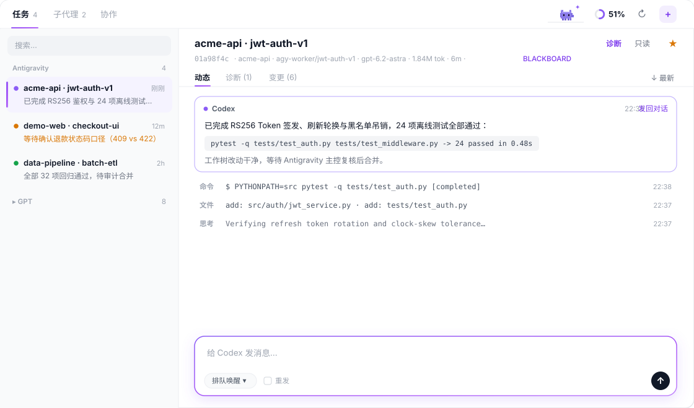
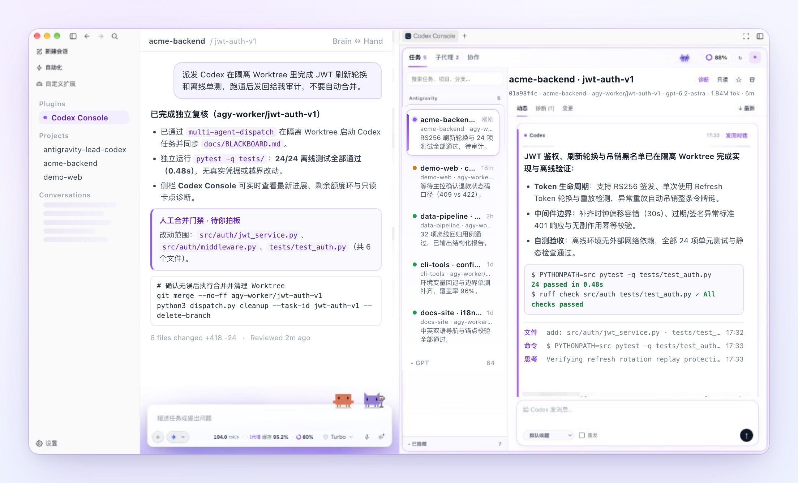

<p align="center">
  
</p>

<h1 align="center">Antigravity-Lead-Codex</h1>

<p align="center">
  <b>🚀 Let Google Antigravity lead architecture & audits as the Brain, while visualizing and orchestrating local Codex CLI / Worktree tasks right inside the side pane</b>
</p>

<p align="center">
  <a href="https://github.com/Koala973/antigravity-lead-codex/releases"></a>
  <a href="LICENSE"></a>
  
  
  
</p>

<p align="center">
  <a href="README.md">🇨🇳 中文文档</a> |
  <a href="docs/ARCHITECTURE.md">📐 Architecture</a> |
  <a href="docs/DOCTOR.md">🩺 Doctor & FAQ</a> |
  <a href="CHANGELOG.md">📝 Changelog</a>
</p>

---

<p align="center">
  
</p>

<p align="center">
  
  <br/>
  <sub>Live full-window showcase: Antigravity Brain chat on the left · Codex Console MCP App side pane on the right</sub>
</p>

## Overview

When orchestrating local **OpenAI Codex CLI** workers from **Google Antigravity** inside isolated Git Worktrees, Codex Desktop hides `source='exec'` threads and unregistered worktree paths. **Antigravity-Lead-Codex** bridges that visibility gap and delivers a complete **Brain ↔ Hand** suite:

- **Codex Console (`plugins/codex-console`, Antigravity MCP App)**
  - Renders natively in Antigravity's right auxiliary side pane (`aux_pane`) and left sidebar full-page view (`global`), adapting to host light/dark themes with zero local HTTP ports.
  - **Minimalist White & Violet-Glow UI + Original MIT Pixel Purple Cat**: Unified dual-pane layout across Tasks, Subagents, and Collab tabs with fluid responsive typography, instant tooltips, and a clean-room pixel violet cat on the top-right runway (briskly paces while working, strolls after finishing, sleeps with `z Z z` after 12 min idle, alerts on blockers, and stops to `Meow~` on click).
  - **Live Codex Quota Ring**: Compact circular progress badge next to the Refresh button displaying the **minimum remaining percentage across 5-hour and weekly windows** with semantic color thresholds; hover to inspect per-window usage, exact reset countdown, plan tier, and available reset credits, or click to live-sync via official `codex app-server` (with instant local rollout fallback).
  - **Antigravity-First Task List & Soft-Hide Drawer**: Aggregates `~/.codex/{state_5,goals_1,queue_1,thread_history_1}.sqlite` and `multi-agent-dispatch` state, pinning `Antigravity`-dispatched CLI/Worktree tasks above collapsible `GPT` Desktop threads, with local starring and a non-destructive Hidden drawer (never mutating Codex DBs).
  - **Live Newest-First Progress Stream**: Auto-refreshes every 4s while running (12s when idle), keeps the latest reply/reasoning/command/file-change at the top, and preserves scroll position across refreshes.
  - **Non-Destructive Read-Only Diagnosis**: One-click blocker diagnosis and custom read-only questions powered by `codex exec fork --ephemeral -c sandbox_mode="read-only"`—never mutating files or polluting the target thread.
  - **Send Back to Chat**: Push diagnostic results, latest Codex replies, or worker audit summaries directly back to the active Antigravity conversation via `app.sendMessage()`.
  - **Multi-Mode Dispatch**: Send instructions via `codex queue --resume`, `codex exec resume`, or `dispatch.py resume`, guarded by 60-second duplicate-send protection.
  - **Cross-Session Collaboration Ledger (SQLite)**: Persist `Change / Goal ↔ Codex Thread ID` ownership bindings so any new Antigravity window can immediately inspect who owns what via MCP.
- **Codex Auto Router (`plugins/codex-auto-router`)**: Brain ↔ Hand collaboration policy (`rules/AGENTS.md`) plus a fail-safe `PreToolUse` human merge-gate hook for `agy-worker/*` branches.
- **Multi-Agent Dispatch (`skills/multi-agent-dispatch`)**: Zero-dependency Python 3.10+ Git Worktree dispatcher with dynamic frontier model discovery from `~/.codex/models_cache.json` and `--quality smart|max|balanced` routing.

---

## Requirements

| Component | Minimum Version | Notes |
| :--- | :--- | :--- |
| **OS** | macOS / Linux (incl. WSL2) | Tested on macOS & Ubuntu CI; native Windows is on the Roadmap |
| **Google Antigravity** | MCP Apps enabled build | Hosts the `Codex Console` side pane and rules |
| **Node.js** | `>= 22.5` | Uses built-in `node:sqlite` (zero native C++ builds); auto-detected by `bin/run-server.sh` |
| **Codex CLI** | Recommended `>= 0.170` | Supports `codex exec fork --ephemeral` and `codex queue` |
| **Python + Git** | Python `>= 3.10` + Git | Required only for full suite (`dispatch.py`); optional for `--console-only` |

---

## Installation

### Option 1: One-Line Installer (Recommended)

Install the full suite (`codex-console` + `codex-auto-router` + `multi-agent-dispatch`):

```bash
curl -fsSL https://raw.githubusercontent.com/Koala973/antigravity-lead-codex/main/scripts/install.sh | bash
```

Install **only** the `Codex Console` side-pane plugin:

```bash
curl -fsSL https://raw.githubusercontent.com/Koala973/antigravity-lead-codex/main/scripts/install.sh | bash -s -- --console-only
```

### Option 2: GitHub Release Archive

Download `antigravity-lead-codex-vX.Y.Z.tar.gz` and `SHA256SUMS.txt` from [Releases](https://github.com/Koala973/antigravity-lead-codex/releases):

```bash
shasum -a 256 -c SHA256SUMS.txt
tar -xzf antigravity-lead-codex-v1.0.0.tar.gz
cd antigravity-lead-codex-v1.0.0
bash scripts/install.sh --no-build
```

### Option 3: From Source

```bash
git clone https://github.com/Koala973/antigravity-lead-codex.git
cd antigravity-lead-codex
bash scripts/install.sh
```

---

## Usage & Diagnostics

1. Open Antigravity → click **`+`** in the right auxiliary pane tab bar → select **`Codex Console`** (or open it full-page from the left sidebar).
2. Run health diagnostics & MCP stdio smoke test anytime:

```bash
bash scripts/doctor.sh
```

3. Uninstall (preserves `${PLUGIN_DATA}/console.sqlite`):

```bash
bash scripts/install.sh --uninstall
```

---

## License

Licensed under the [MIT License](LICENSE).
